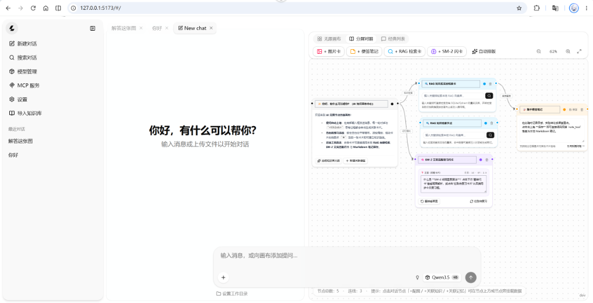
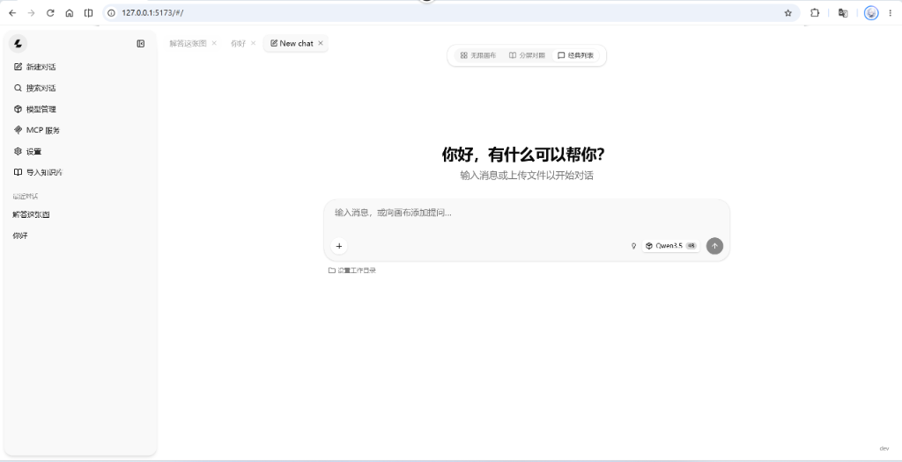
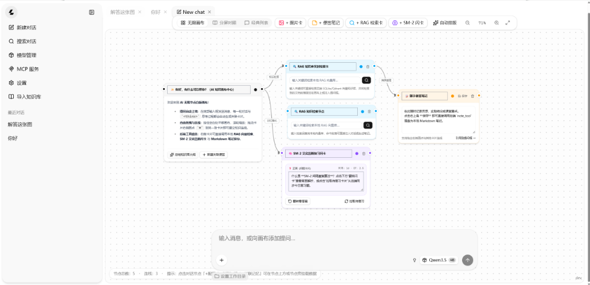

# 🤖 通用智能体与知识图谱闭环控制系统 (General-Purpose Agent Framework)

本项目基于开源项目 **Hello Agent** 的架构设计搭建后端，前端基于 **llama.cpp WebUI** 定制无限知识画布与双向溯源交互界面。

---

## ⚙️ 核心架构与闭环控制机制

### 1. 最原始的闭环控制逻辑
系统内置一套完整的状态反馈与自演进工具链，构成一个**“基于 RAG 检索知识源生成测试 -> 自动化混合裁决评估 -> 基于记忆衰减（SM-2）计算下一次重放时间 -> 自动收集失败任务并编排优化流水线”**的闭环控制系统：
- **知识节点与依赖图谱管理 (`knowledge_tool`)**：管理知识域（Domain Namespace）、核心知识节点（Knowledge Nodes）、前置依赖边与多类型语义边（`prerequisite` / `causal` / `similar` / `branch_followup`）。
- **RAG 知识源驱动的测试任务生成 (`quiz_tool`)**：结合混合向量检索（Dense + BM25 RRF + Cross-Encoder Rerank）与查询扩展（MQE / HyDE），基于权威文档切片自动构造结构化验证任务并挂载于会话上下文。
- **自动化混合裁决评估 (`grade_tool`)**：客观任务走确定性规则快判（毫秒级返回），主观或判否任务降级至 LLM 结构化 rubric 深度归因裁决。
- **基于记忆衰减（SM-2）的重放调度与 EMA 稳健度更新 (`review_tool`)**：依据裁决评分 $q \in [0, 5]$ 动态计算下一次重放间隔（Interval）、易度因子（Easiness Factor）与指数移动平均（EMA）节点稳健度，自动收集失败样本进入待回归队列。
- **状态遥测诊断与优化流水线编排 (`progress_tool`)**：聚合全局节点稳健度分布与薄弱环节，自动编排分阶段优化执行流水线。

### 2. 数据删除与状态变更安全边界
- **删数据的逻辑：Agent 端严禁硬删除，业务端采用软状态标记（Soft Resolve），仅在底层维护受用户作用域隔离的级联物理删除。**
  - **Agent 工具层**：严禁暴露任何物理硬删除能力；针对失败样本队列仅允许通过 `resolve` 动作执行软状态标记（`resolved = 1`），完整保留历史裁决轨迹以供审计与回溯。
  - **底层存储与 REST 边界**：仅在底层存储引擎（`LearningStore.delete_knowledge_point`）维护受 `(user_id, course_id)` 严格作用域校验的级联物理删除，自动清理关联的语义关系边（`kp_relations`）、前置依赖边（`kp_prereq`）、稳健度状态（`mastery`）及关联图谱节点。

---

## 📸 界面与实机效果预览

| 💡 分屏对照与无限知识画布 | 💬 经典纯净对话界面 |
| :---: | :---: |
|  |  |

### 🧠 无限画布节点与卡片联动
> 针对传统对话“上下文难切分、缺乏结构化沉淀”的痛点，支持在无限画布上自由串联 **AI 知识中心**、**RAG 知识库实时检索卡**、**SM-2 衰减重放卡** 与 **随手便签卡片**：



---

## 📁 目录结构

```text
xiaoxiao/
├── app/
│   ├── agent/               # Agent 核心逻辑：ReAct 循环 (loop.py)、通用系统 Prompt 与自我反思
│   ├── api/                 # API 路由：兼容 llama.cpp (/props, completions, /mcp) 及闭环控制专用路由
│   ├── context/             # GSSC 上下文构建器（KV Cache 友好的提示词组装与 Token 预算控制）
│   ├── core/                # 核心配置 (config.py)、依赖注入容器 (container.py)、生命周期
│   ├── learning/            # 闭环控制核心：SM-2 衰减调度、EMA 稳健度、IntentRouter、状态存储库
│   ├── llm/                 # LLM 客户端抽象、多模态解析、OpenAI 协议封装与结构化输出
│   ├── memory/              # 四层记忆体系：工作记忆、感知记忆、语义记忆、情境记忆及生命周期
│   ├── observability/       # 日志追踪与对话轨迹记录
│   ├── query/               # 查询扩展（MQE 多查询生成与 HyDE 假设性文档检索）
│   ├── rag/                 # 文档页级切片 (chunker)、加载 (loader)、管道与混合检索 (retriever)
│   ├── schemas/             # Pydantic 数据规范与 SSE 事件协议
│   ├── session/             # 会话状态管理器
│   ├── storage/             # 存储适配器：SQLite（含自研余弦向量检索）、Qdrant、Neo4j、Redis 缓存
│   ├── tools/               # 工具系统：闭环控制工具（测试生成/混合裁决/重放调度/流水线编排）、RAG/Web/终端/笔记工具
│   └── main.py              # FastAPI 应用入口与中间件挂载
├── llama-webui/             # 基于 llama.cpp 官方 WebUI 定制的前端工程 (SvelteKit + TailwindCSS)
│   └── tools/ui/            # WebUI 源代码
├── data/                    # 本地数据目录：agent.db、文档上传目录、状态与笔记记录
├── tests/                   # 单元测试与端到端集成测试集
├── cli.py                   # 通用智能体彩色交互式终端（单文件开箱即用体验）
├── pyproject.toml           # 后端 Python 项目依赖与配置
├── docker-compose.yml       # 可选：快速启动 Qdrant/Neo4j/Redis 服务的 Compose 文件
└── .env.example             # 环境变量配置示例
```

---

## 🚀 快速上手与运行指南

系统支持完全在本地离线单机运行。

### 第一步：环境准备
- **Python**: 推荐 3.11 或 3.12
- **Node.js**: 推荐 18.x 或以上（用于运行 WebUI）
- **包管理工具**: 推荐 `uv`（极速）或者直接使用 `pip`

```bash
# 1. 进入项目根目录
cd e:\xiaoxiao

# 2. 安装 Python 后端依赖
pip install -e .
# 或者使用 uv：
# uv sync
```

### 第二步：配置环境与模型
复制环境变量配置文件：
```bash
cp .env.example .env
```
打开 `.env` 文件，根据实际情况配置主模型与 Embedding 模型地址。
- **本地部署推荐**：
  - 启动主推理模型（如 Gemma 系列或 Qwen 系列）：
    `llama-server -m your-model.gguf --port 8083`（同样兼容 Ollama 等一切 OpenAI 协议服务端）
  - 启动向量模型（如 BGE 或 Qwen-Embedding）：
    `llama-server -m your-embed-model.gguf --port 8084 --embedding`（用于 RAG 向量检索）
- **云端 API 兼容**：
  如需使用 DeepSeek 或其他云端大模型，直接修改 `.env` 中的 `LLM_BASE_URL` 与 `LLM_API_KEY` 即可。
- **外部存储**：
  若不配置 Qdrant / Neo4j / Redis，系统将自动无缝降级使用本地 SQLite。

---

### 第三步：运行方式

#### 方式 A：启动后端服务 + WebUI 界面（推荐）

1. **启动 FastAPI 后端**（负责路由代理、RAG 检索、四层记忆管理、闭环控制与 MCP 服务）：
```bash
uvicorn app.main:app --host 127.0.0.1 --port 8000 --reload
```

2. **启动前端 WebUI**：
```bash
cd llama-webui/tools/ui
npm install
npm run dev
```
打开浏览器访问 `http://localhost:5173`。

> 前端通过 Vite 代理访问后端，默认目标是 `http://127.0.0.1:8000`。若后端端口不同，在 `llama-webui/tools/ui/.env` 中设置 `VITE_PUBLIC_SERVER_ORIGIN='http://127.0.0.1:<端口>'` 后再启动。也可以先 `npm run build`，再由后端直接托管构建产物（单端口部署）。

---

#### 方式 B：直接使用彩色交互终端 CLI

无需打开浏览器，在命令行即可流式观察 Thought-Action-Observation 推理步并执行闭环控制指令：

```bash
python cli.py --user demo_user
```

---

## ⌨️ 终端 CLI 快捷指令速查表

| 指令 | 示例 | 功能说明 |
| :--- | :--- | :--- |
| **自由交互** | `解析分布式共识算法 Raft 的 Leader 选举机制` | 自动识别意图：检索本地知识库并展开结构化解析 |
| `/quiz` | `/quiz Raft选举机制 choice` | 基于 RAG 知识源生成结构化测试任务（可选 `choice` / `fill` / `short_answer`） |
| `/answer` | `/answer B` | 提交当前待评估任务响应，触发混合裁决、更新稳健度并计算 SM-2 重放时间 |
| `/review` | `/review` | 查看今日到期需要重放的知识节点与待回归失败样本队列 |
| `/progress`| `/progress` | 查看当前状态遥测报告、稳健度分布与薄弱节点 |
| `/plan` | `/plan 分布式一致性核心突破` | 基于当前薄弱节点自动编排阶段性优化流水线 |
| `/kp` | `/kp` 或 `/kp Raft日志复制 \| 状态机安全约束` | 查看已有知识节点图谱或录入新知识节点 |
| `/course` | `/course` 或 `/course 分布式系统` | 查看知识域列表或切换/新建知识域命名空间 |
| `/image` | `/image "D:\diagrams\arch.png" 解析该架构图的数据流` | 多模态图像输入解析与结构化问答 |
| `/ingest` | `/ingest "D:\docs\raft-paper.pdf"` | 将本地 PDF/Markdown/文本导入 RAG 向量知识库 |
| `/memory` | `/memory` | 查看当前智能体沉淀的四层记忆 |
| `/tools` | `/tools` | 查看系统当前已挂载激活的所有内置与闭环工具 |
| `/new` | `/new` | 开启一个全新的对话会话 |
| `/exit` | `/exit` 或 `/quit` | 退出交互终端 |

---

## 🔒 知识库隔离、真实溯源与安全边界（Fix Round P0-P2）

1. **P0：真实文档归因与作用域隔离**
   - 划词建卡真实归因：`POST /api/rag/attribute` 把选中文本归因到知识库真实切片（字符三元组包含度达标才算命中），只有命中才写入 `doc_id / chunk_id / 页号`。
   - 文档溯源预览渲染真实原文：`GET /api/rag/documents/{doc_id}/file|page` + 浏览器 pdf.js 单页渲染（非 PDF 显示抽取页文本）。
   - 会话作用域收口：`ToolContext` 携带 `rag_namespace/course_id`，`rag_search_tool` 严格绑定会话命名空间；画布 RAG 检索卡、知识库对话框、知识节点写库统一走会话绑定的知识域与命名空间（`learning-context`）。
   - 数据归属与级联物理删除校验：`knowledge_points` 绑定 `user_id`，跨知识域/跨用户查询、改写、建关系、回滚一律拒绝；底层删除知识节点接口受用户作用域隔离并级联清理语义边、前置依赖与稳健度记录。

2. **P1：闭环一致性**
   - 版本以后端 `history_json` 为唯一事实源：前端每次写入成功后采纳后端版本/历史，删除画布节点同步删后端，画布加载时自动从后端补齐知识节点与语义关系。
   - 画布对话卡片支持“分支 x/y ◀▶”指示与无损切换；记忆 consolidate/remove 严格按会话作用域执行。

3. **P2：边界与验证**
   - 可选 `API_TOKEN`：设置后除 `/health` 外所有接口需 `Authorization: Bearer <token>`（WebUI 设置里的 API Key 填同一个值即可）。
   - 真浏览器全栈 E2E（离线 FakeLLM + 真实 FastAPI + Vite dev server）：划词建卡、锚点跳转、分支切换、真实 PDF 页预览。

```bash
# 全栈浏览器 E2E（会自动启动离线后端 + 前端 dev server）
cd llama-webui/tools/ui && npm run test:e2e:fullstack
```

---

## 🌐 联网资料「临时知识库 → 提纯 → 晋升」流程（可选，默认关闭）

为了避免联网内容直接污染正式知识库，引入 Bronze/Silver/Gold 三层架构：

1. **临时知识库（Staging，Bronze）**：知识库面板的「联网导入」可通过 URL 抓取或搜索发现网页，内容先落到独立 `staging_{embedder}` 向量集合与快照文件；也可以由对话在本地资料不足时（`WEB_FALLBACK_MODE=auto`）通过 MCP/搜索 Provider 自动补充并暂存。临时库**不参与标准 RAG 检索**，默认 7 天 TTL 自动清理。
2. **提纯候选（Silver）**：对临时网页点击「提纯」→ 规则清洗 + 质量分 + LLM 结构化提炼成知识节点候选（标题/摘要/要点/原文证据），进入「待入库知识候选」列表，可勾选或驳回。
3. **晋升标准知识库（Gold）**：勾选候选 →「晋升到正式库」→ 后端把网页快照重新入库到目标知识域 namespace，并创建知识节点卡片（画布加载时自动补齐）。晋升可一键撤销（删除标准文档与由它创建的知识节点）。

---

## 致谢与参考

- 核心架构深度参考了开源项目 **[Hello Agent](https://github.com/datawhalechina/hello-agent)**。
- 前端与推理底座基于开源项目 **[llama.cpp](https://github.com/ggerganov/llama.cpp)**。
